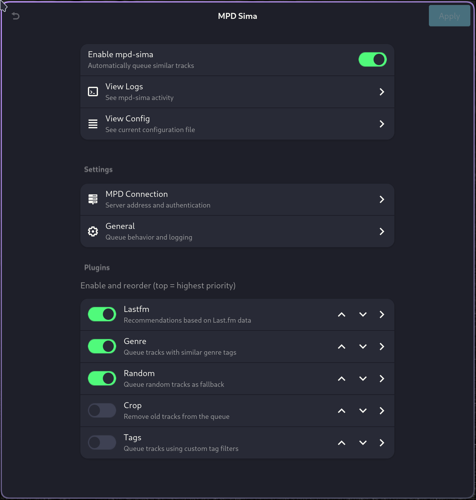

# mpd-sima-gui

A GTK4/Adwaita graphical interface for managing
[mpd-sima](https://kaliko.me/mpd-sima/), the automatic queue management
daemon for MPD (Music Player Daemon).

## Overview

mpd-sima-gui provides a system tray application that lets you easily
control and configure mpd-sima. It handles starting/stopping the
daemon, configuring MPD connection settings, and managing the various
plugins that determine how similar tracks are queued.

## Features

- **System Tray Integration**: StatusNotifierItem-based tray icon with
  context menu
- **Process Management**: Automatically starts and manages the
  mpd-sima subprocess
- **Configuration UI**: Intuitive settings interface for all mpd-sima
  options
- **Plugin Management**: Enable, disable, and reorder the five
  built-in plugins
- **Log Viewer**: Real-time log viewing with auto-scroll
- **Change Detection**: Apply button activates only when settings
  have changed

## Screenshot



The application runs in the system tray:
- Left click: Open settings
- Middle click: Toggle enable/disable
- Right click: Context menu

## Installation

### Requirements

- Python 3.10+
- GTK4
- libadwaita
- PyGObject
- mpd-sima

### Using pip

```bash
pip install .
```

### Using Nix Flakes

```bash
# Run directly
nix run .

# Build the package
nix build

# Enter development environment
nix develop
```

## Usage

### Starting the Application

```bash
mpd-sima-gui
```

Or run as a module:

```bash
python -m mpd_sima_gui
```

On first launch, the application starts the mpd-sima daemon and
creates a system tray icon. The settings window can be opened by
left-clicking the tray icon.

### Configuration

Configuration is stored at `~/.config/mpd-sima-gui/mpd_sima.cfg`.

#### MPD Settings

- **Host**: MPD server hostname (default: localhost)
- **Port**: MPD server port (default: 6600)
- **Password**: Authentication password (optional)

#### General Settings

- **Queue Length**: Number of tracks to auto-queue (default: 2)
- **History Duration**: Hours to remember played tracks (default: 8)
- **Use MusicBrainz IDs**: Enable MusicBrainz ID matching
  (default: true)
- **Log Level**: Verbosity of logging (debug, info, warning, error)

#### Plugins

Five internal plugins are available, each with its own configuration:

| Plugin | Priority | Description                      |
|--------|----------|----------------------------------|
| Lastfm | 100      | Last.fm-based recommendations    |
| Genre  | 80       | Genre-based similar track match  |
| Tags   | 80       | Custom tag-based filtering       |
| Random | 50       | Random track fallback            |
| Crop   | 10       | Queue cleanup                    |

Plugins can be enabled/disabled and reordered by dragging them up or
down in the settings.

## File Locations

| Path                                    | Description        |
|-----------------------------------------|--------------------|
| `~/.config/mpd-sima-gui/mpd_sima.cfg`   | Configuration file |
| `~/.cache/mpd-sima-gui/mpd-sima.log`    | Log file           |

## Development

### Setting Up

```bash
# Enter development environment with all dependencies
nix develop

# Run the application
python -m mpd_sima_gui
```

### Project Structure

```
mpd-sima-gui/
├── mpd_sima_gui/
│   ├── __init__.py         # Package metadata
│   ├── __main__.py         # Module entry point
│   ├── main.py             # Application entry point
│   ├── app.py              # Main GTK4/Adwaita application
│   ├── config.py           # Configuration management
│   ├── process.py          # mpd-sima subprocess management
│   ├── settings_dialog.py  # Settings UI
│   ├── tray.py             # System tray icon (DBus)
│   └── log_viewer.py       # Log viewing dialog
├── logos/                  # SVG tray icons
├── pyproject.toml          # Python package configuration
└── flake.nix               # Nix development environment
```

## Dependencies

### Python Packages

- PyGObject >= 3.42.0
- pycairo >= 1.20.0

### System Libraries

- GTK4
- libadwaita
- GObject Introspection
- GdkPixbuf

## Related Projects

- [mpd-sima](https://kaliko.me/mpd-sima/) - The backend daemon this
  GUI controls
- [MPD](https://www.musicpd.org/) - Music Player Daemon

## License

See LICENSE file for details.
